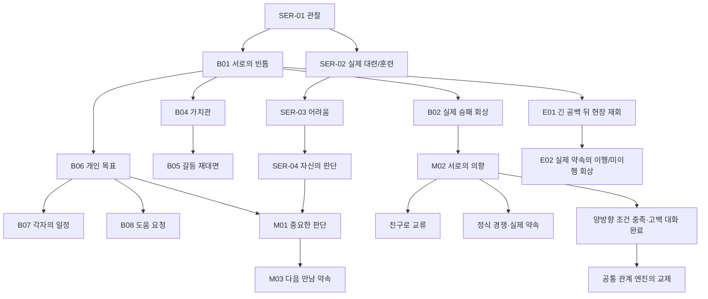

# 세레나 자유 교류·선택적 심화 루트 v1

2026-10-27. **부분 완료**: 세레나22사건의 실제 조건/장면/선택/실행 연결과 대표 플레이 분기를 구현했다. 모든22사건의 모든 선택, 새 회차부터 졸업까지의 완주, 진로 전환을 완료했다고 주장하지 않는다.

## 공식 설정과 범위

`data/characters/serena.ts`의 용사라는 기존 신분·성격·기본 능력을 유지한다. 책임감과 친절함, 타인의 선택을 존중하려는 태도, 기대에 대한 부담, 친구를 찾고 싶은 바람을 활용했다. 새로운 혈통·이계 능력·추가 고정 학생은 없다.

앞선15인 v2 작업에서 작성한 개인50장면/148선택 초안은 `data/characters/personalScenes.json`에 보존했다. 이번에는 그 중 세레나4장면만 런타임에 붙였으며 나머지14명의 심화 루트를 대량 활성화하지 않았다. 기존 개인50/교차12의 ID와 실행 경로는 유지한다.

## 세레나22사건

공통: 실제 같은 장소·정지 상태·유효한 참가자·출입·선행 경험을 확인한다. 새18건의 상대는 실제 플레이어다. 기존 개인4건은 다른 NPC와도 진행한다. 아래 조건은 핵심 요약이며 원본의 선언형 조건이 권위다.

|코드|분류·이름|주요 실제 조건·결과|
|---|---|---|
|SER-01|개인·관찰|상대의 공부/검술/마법 훈련 관찰. 공부 중에는 도입 대사도 달라진다. 관점 교환 또는 실제 대련 제안.|
|SER-02|개인·실력 확인|SER-01 완료, 대련장, 상대 검술2 이상. 대련/공동 훈련/거절. 승패는 공통 전투가 결정.|
|SER-03|개인·혼자 해결하려는 일|SER-02 이후 실제 피로70 이상. 도움 요청 또는 독립성/다른 의견 표현.|
|SER-04|개인·자신의 선택|SER-03 이후 피로50 이하. 세레나가 혼자 생각을 정리할 수도 있다. 장기 목표 달성을 지급하지 않음.|
|SER-D01|일상·훈련장의 짧은 인사|대련장에서 실제 만남. 공동 훈련/구경/짧은 인사.|
|SER-D02|일상·수업의 여백|세레나가 실제 수업 참석 중. 질문/공감/수업 집중. 출석·성적을 조작하지 않음.|
|SER-D03|일상·다음 연습 시간|D01 이후1일, 대련장, 피로60 이하. 실제 훈련 또는2시간 뒤 약속 제안.|
|SER-D04|일상·용감하게 생긴 별|도서관, 신뢰15 이상. 서툰 그림을 둘러싼 가벼운 대화. 아이템이나 특별 재능을 생성하지 않음.|
|SER-D05|일상·행사 뒤의 인사|세레나의 실제 학내 행사 도메인 신호(EVT-01/FEST-03/EVT-07). 행사 성과를 새로 만들지 않음.|
|SER-B01|심화·서로의 빈틈|SER-01 이후2일, 공유 경험2건, 존경15 이상, 대련장. 평가·공동 훈련·경계 존중.|
|SER-B02|심화·대련 다음의 말|B01 이후2일, 실제 대련 기억. 세레나의 승리/패배에 따라 도입 대사 변경. 재대련 약속 가능.|
|SER-B03|심화·어긋난 공동 활동|D03 이후 실제 실패/중단 경험. 분담 요청/책임 논의/거리 두기.|
|SER-B04|심화·도움의 경계|B01 이후4일, 신뢰20 이상. 가치관 동의 또는 실제 논쟁. 갈등을 무조건 만들거나 지우지 않음.|
|SER-B05|심화·다시 마주친 사이|B04 이후2일, 실제 부정적 호감 또는 신뢰. 화해 요청/차이 인정/거리 두기.|
|SER-B06|심화·호칭 밖의 바람|B01 이후7일, 공유 경험3건, 신뢰35 이상, 실제 활성 목표. 개인적인 바람을 나눔.|
|SER-B07|심화·서로 다른 오늘|B06 이후4일, 실제 자율 학습 중. 공동 공부 또는 각자의 일정 존중.|
|SER-B08|심화·먼저 내미는 부탁|B06 이후2일, 실제 피로65 이상. 도움 요청/거절 존중/직접 담당자에게 요청하겠다는 의향.|
|SER-M01|중요·내가 정하는 몫|SER-04와 B06 이후 각7일. 독립적인 결정과 실제 도움의 범위를 구분.|
|SER-M02|중요·이름을 붙인다면|B02 이후7일, 양방향 신뢰40 이상, 공유 경험3건. 우정/정식 경쟁/상호 교제의 선택.|
|SER-M03|중요·다음 만남의 약속|M01 이후7일, 신뢰30 이상. 실제2시간 뒤 만남 또는 약속하지 않을 자유.|
|SER-E01|장기·오랜만이야|431년 이후, B01 이후360일 이상, 실제180일 이상 연락 공백, 실제 현장 재회. 졸업·취업을 했다고 단정하지 않음.|
|SER-E02|장기·남겨둔 시간|E01 이후7일, 실제 이행/미이행 약속 기록. 과거 약속의 결과에 따라 다른 도입.|

## 주요 인과관계와 관계 방향

화살표는 발생 가능성을 활성화한다. 실제 위치·기억·시간·관계 조건을 만족하기 전에는 후속 사건을 발생한 사실로 기록하지 않는다. 거절/실패 때문에 후속 사건이 발생하지 않을 수 있다. 관계 방향은 고정 루트 슬롯이 아니며 다른 히로인의 일상/개인 사건을 차단하지 않는다.

M02의 연애 선택에는 **양방향 호감65/신뢰55/친밀50 이상**과 아직 상호 연인이 아님이 필요하다. 대화 완료 전에는 교제 태그가 생기지 않는다. NPC의 의향 조건과 플레이어의 명시적 응답을 함께 확인한다. 우정은 낮은 등급의 결말이 아니다. 정식 대련 약속을 서로 받아들이면 공통 대화 엔진이 라이벌 관계를 기록한다. 이 로직은 세레나 이름에 하드코딩하지 않는다.

## 재사용 구조와 실제 실행

- `WorldEventDefinition.personalScene`과 선택 상태만 확장했다. 별도 NPC/시간/관계/성장 엔진은 없다.
- 선택→반응→확인을 저장한다. 반응을 읽은 뒤 실제 상호작용을 요청한다. 말 한마디로 연구·성장·치료·화해를 완료하지 않는다.
- 플레이어가 당사자일 때만 선택을 기다린다. NPC의 자율 선택은 실제 관계/피로와 결정적인 시드를 사용하며 플레이어의 대사를 다른 NPC가 말한 것처럼 복제하지 않는다.
- 대련이 일찍 끝나거나 패자가 치료 장소로 옮겨져도, 공통 상호작용이 실제 현장에서 완료한 결과를 먼저 반영한다. 실패/중단은 성공으로 바꾸지 않는다.
- 일상은 같은 상대와1일 간격, 심화/중요/장기는 같은 상대와3일 간격을 공유한다. 기존 개인 사건과 다른 인물의 일상을 전역 잠그지 않는다.
- 관계/인물/장소 인덱스의 관련 기억을 조회한다. 장기 연락 공백은 실제 개인 사건의 보존 기록도 확인한다. 흐려진 기억과 과거에 실제 발생했다는 기록을 구분하며 전지적인 정보나 새 보상을 만들지 않는다.
- 일반 인물 상세에는 당사자 경험 또는 실제 전달받은 기록만 표시한다. 미래 사건 조건/전체 분기/다른 NPC의 내부 판단은 개발자 관찰에만 노출한다.
- 기존 세이브에서 새 루트의 시간 트리거가 누락된 경우에만 멱등적으로 보충한다. 이미 있는 예약/발생/선택을 재추첨하지 않는다.
- 저장 필드는 기존 세계 이벤트의 선택적 확장이다. 새20여건은1회성·기존 보존 예산 안에서 관리하며 별도의 무제한 일지를 만들지 않았다.

## 실제 게임 UI

같은 장소의 인물 상세 → **지금 나눌 수 있는 이야기** → 배경/스탠딩/대사/조건부 선택 → 선택에 맞는 반응 → 확인 후 실제 시간 진행. 인물 탭의 **함께 알게 된 이야기**에는 알려진 선택·반응·상태만 남긴다. 기존 이벤트/VN/전투 팝업과 원화를 재사용한다.

## 검증 결과와 한계

- `test:academy-personal-scenes`:50개 초안의 공통 장면 코어/148선택 데이터, 권한/반응 저장/손상 복원 거부/실제 상호작용 실패/정중한 거절 무벌점/개별 기억/자율 분기/분할 시간/구형 예약 보충 검사. **다른14명의 심화 루트 실행 검증이 아니다.**
- `test:academy-serena-route`: 준비된 관계·시간·휴식 상태의 세레나 통합 fixture. 실제 선행 사건과 대련/훈련을 수행한 뒤 우정/경쟁/상호 교제/일방적 교제 차단/갈등·거리두기/관계 종료·방향 변경/비개입·다른 NPC 상대/다른 히로인 사건 공존/선택 저장 복원을 검사했다.
- 대표 fixture는5인, AI 자율 진행을 끄고 기회를 수동 선택했다. 참가자/선행 조건은 유지하지만 자동 트리거/후속 예약은 분리했으며 장면 사이 회복을 명시적으로 준비했다. 약14일의 시간 축을 사용한 **기능 통합 검사**다. 실제100NPC 성능 수치나 새 게임 전체 플레이 완주로 해석하지 않는다.
- 431년 재회는 위에서 실제 수행해 저장한 과거 사건을 준비된431년 세계에 복원하여 현장에서 실행했다.4년 전체 AI 시뮬레이션이나 실제 졸업 처리를 수행한 검사가 아니다.
- 기존 세계 이벤트·사건망·고정 학생·대화 계약을 변경 영향에 맞춰 검사했다. 전체 브라우저 회귀/30일 이상 시뮬레이션은 실행하지 않았다.
- 실제 브라우저: 새25NPC 회차08:00→10:30, 대련장 세레나 상세의 D01 기회, 일정에 따른 훈련 선택 비활성화, 선택별 반응, 확인 후10:31 자동 진행, 빈 슬롯3 저장/페이지 재로드/동일한 알려진 기록1건 복원, 콘솔 오류0 확인.
- 원본 결과: `test-results/academy-serena-route/results.json`, `test-results/academy-personal-scenes/results.json`, `test-results/academy-serena-*.log`.
- 화면: `test-results/academy-serena-route/scene-response.png`, `known-history-after-load.png`. 초기 `scene-choice.png`는 대사 줄바꿈 보정 전 캡처다.

## 미완료·후속

1. 실제 졸업/학적·직업/거주지·연락 수단의 완전한 전환은 기존 의존성이 없어 미구현이다. 졸업 이후에만 가능한 전용 직업 장면이나 원격 재회는 만들지 않았다.
2.22개 전부/모든 선택/모든 승패·약속 결과의 실제 장기 플레이 완주는 미검증이다. 자동 발생 빈도와 장기 관계 밸런스도 후속 플레이 검증이 필요하다.
3.균열의 시대 지역 위기를 직접 원인으로 삼는 세레나 전용 재회 사건은 이번22건에 추가하지 않았다. 기존 세계 위기와 일상은 함께 진행하지만 이를 전용 위기 분기 완료로 표시하지 않는다.
4.나머지14명의 심화 루트는 확장하지 않았다. 이전50장면 초안과 기존 개인/교차 사건을 보존한다.
5.100NPC 7일 성능 목표는 이번 기능 검사의 측정 대상이 아니다.

## 변경 파일과 최종 검사

- 콘텐츠/타입: `data/heroineRoutes/serena.ts`, `data/characters/{stories,personalScenes}.ts`, `personalScenes.json`, `types/{personalScene,worldEvent,actionEffects}.ts`, `data/worldEvents/index.ts`.
- 실행/공개 투영: `systems/{worldEvents,playerLife,personalStories,conversations,npcMemory}.ts`.
- UI: `components/{PersonalSceneDialog,HeroineOpportunities,PlayerResponseDialog,CharacterStories,NpcActionPanel,EventScene}.tsx`.
- 검사/등록: `scripts/test-academy-{personal-scenes,serena-route}.mjs`, 기존 world-events/story-network/fixed-students 검사의 명시적 카탈로그 수/새 자율 선택 계약, `package.json`, `scripts/academy-validation-registry.mjs`, 기능 노트/프로젝트 컨텍스트/구현 현황.
- 최종 통과: 전용 장면 코어·세레나 통합, 기존 고정 학생·세계 이벤트·사건망·대화·기억의 FAST/INTEGRATION, 기능 노트, 변경 파일 lint, `npm run build`(타입 포함),39페이지 메타데이터 및182개 배포 참조 검사. 원본 로그를 보관했다.
- 빌드의 기존 큰 JS 청크 경고는 남아 있다. 이번 작업에서 엔진 전체 분할이나100NPC 성능 최적화를 했다고 주장하지 않는다.
